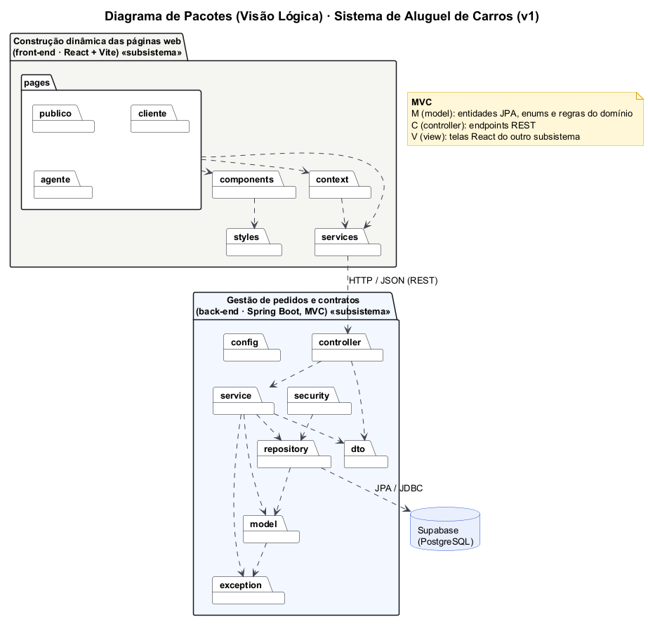
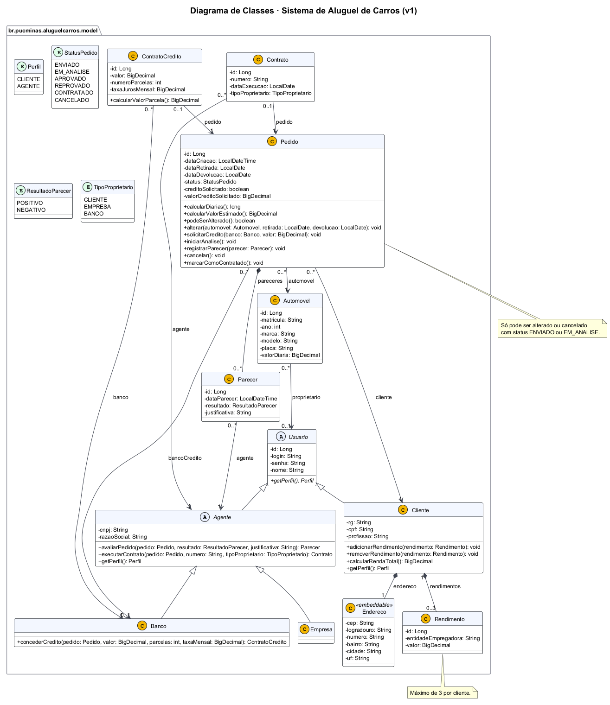

---

# 🚗 Rota · Sistema de Aluguel de Carros 👨‍💻

> [!NOTE]
> Sistema web para **efetuar, modificar, consultar e cancelar pedidos de aluguel de automóveis**, com análise financeira feita por agentes (empresas e bancos) e execução de contratos, inclusive com crédito bancário.

<table>
  <tr>
    <td width="800px">
      <div align="justify">
        O <b>Rota</b> é o Laboratório 02 da disciplina <i>Desenvolvimento e Integração de Aplicações Web (DIAW)</i> do curso de Engenharia de Software da PUC Minas. Clientes cadastrados montam pedidos de aluguel escolhendo o automóvel e o período, podendo pedir crédito a um banco. Os agentes (locadoras e bancos) avaliam cada pedido do ponto de vista financeiro e, com parecer positivo, executam o contrato. O back-end segue a arquitetura <b>MVC</b> com <b>Spring Boot</b>, o front-end usa <b>React + Vite</b> e os dados ficam no <b>Supabase (PostgreSQL)</b>, com acesso restrito a usuários autenticados.
      </div>
    </td>
    <td>
      <div>
        
      </div>
    </td>
  </tr>
</table>

---

## 🚧 Status do Projeto

       

| Etapa do processo | Situação |
|---|---|
| Modelagem (casos de uso, histórias, classes e pacotes) | ✅ v1 |
| Autenticação (login de clientes e agentes) | ⏳ |
| CRUD de cliente | ⏳ |
| Protótipo (criar pedido e ver o status) | ⏳ |
| Revisão dos diagramas | contínua |

---

## 📚 Índice
- [Links Úteis](#-links-úteis)
- [Sobre o Projeto](#-sobre-o-projeto)
- [Funcionalidades Principais](#-funcionalidades-principais)
- [Tecnologias Utilizadas](#-tecnologias-utilizadas)
- [Arquitetura](#-arquitetura)
  - [Modelagem UML](#modelagem-uml)
  - [Versões dos modelos](#versões-dos-modelos)
- [Instalação e Execução](#-instalação-e-execução)
  - [Pré-requisitos](#pré-requisitos)
  - [Variáveis de Ambiente](#-variáveis-de-ambiente)
  - [Instalação de Dependências](#-instalação-de-dependências)
  - [Banco de Dados (Supabase)](#-banco-de-dados-supabase)
  - [Como Executar a Aplicação](#-como-executar-a-aplicação)
- [Deploy](#-deploy)
- [Estrutura de Pastas](#-estrutura-de-pastas)
- [Demonstração](#-demonstração)
- [Testes](#-testes)
- [Documentações utilizadas](#-documentações-utilizadas)
- [Autores](#-autores)
- [Contribuição](#-contribuição)
- [Agradecimentos](#-agradecimentos)
- [Licença](#-licença)

---

## 🔗 Links Úteis
* 🎨 **Wireframes no Figma:** [Rota – Aluguel de Carros (LAB02)](https://www.figma.com/design/vPTstldZsygAGqDP3DTjqx)
  > 18 telas (área pública, cliente e agente) e a folha de componentes.
* 🖼️ **Wireframes em HTML:** [`docs/wireframes/wireframes.html`](docs/wireframes/wireframes.html)
  > Mesmas telas, geradas por `docs/wireframes/gerar_wireframes.py`. É a referência visual do front-end.
* 📐 **Modelagem:** [`docs/modelagem`](docs/modelagem)
  > Histórias de usuário e diagramas UML (fonte PlantUML + imagem).

---

## 📝 Sobre o Projeto
Locadoras e bancos precisam de um jeito simples de receber pedidos de aluguel pela internet, analisar a situação financeira de quem pede e formalizar o contrato. O Rota junta os três lados no mesmo sistema:

- **Clientes** (pessoas físicas) se cadastram com RG, CPF, endereço, profissão e até 3 rendimentos, e então criam, modificam, consultam e cancelam pedidos de aluguel.
- **Agentes** (empresas e bancos) avaliam os pedidos com um parecer financeiro. Com o parecer positivo, o agente executa o contrato e define em nome de quem o automóvel fica registrado (cliente, empresa ou banco).
- **Bancos** também podem conceder um **contrato de crédito** associado ao aluguel.

O sistema só pode ser usado depois do cadastro e do login com usuário e senha.

---

## ✨ Funcionalidades Principais
- 🔐 **Autenticação:** cadastro e login de clientes e agentes. Todas as telas e rotas da API exigem login.
- 👤 **CRUD de cliente:** dados pessoais, endereço, profissão e até 3 rendimentos.
- 📝 **Pedidos de aluguel:** escolha do automóvel e do período, valor estimado pelas diárias, e alteração ou cancelamento enquanto o pedido está em análise.
- 🔎 **Acompanhamento do status:** `Enviado → Em análise → Aprovado / Reprovado → Contratado`, ou `Cancelado`.
- ⚖️ **Parecer financeiro:** o agente vê a renda total do cliente e aprova ou reprova o pedido com uma justificativa.
- 🏦 **Crédito bancário:** o cliente pede crédito a um banco, e o banco define o valor, as parcelas e a taxa (tabela Price).
- 📄 **Contratos:** execução do contrato e registro do proprietário do automóvel.
- 🚙 **Frota:** a empresa cadastra os automóveis (matrícula, ano, marca, modelo, placa e diária).

---

## 🛠 Tecnologias Utilizadas

### 💻 Front-end
* **Biblioteca:** React 18
* **Linguagem:** JavaScript (ES2022+)
* **Estilização:** CSS com tokens próprios (`src/styles/tokens.css`), fontes Sora, Inter e JetBrains Mono
* **Build Tool:** Vite 5

### 🖥️ Back-end
* **Linguagem/Runtime:** Java 25 (JDK 25)
* **Framework:** Spring Boot 4.0.9 (Web MVC, Data JPA, Validation)
* **Build e dependências:** Apache Maven
* **Banco de Dados:** Supabase (PostgreSQL)
* **ORM:** Hibernate / JPA
* **Autenticação:** login com usuário e senha (Spring Security + BCrypt)

### ⚙️ Infraestrutura & Ferramentas
* **Banco gerenciado:** Supabase
* **Modelagem:** PlantUML
* **Protótipo:** Figma
* **Testes:** JUnit 5, AssertJ e H2 em memória para validar o mapeamento JPA

---

## 🏗 Arquitetura

O sistema tem os **dois subsistemas** do enunciado, ligados por uma API REST:

1. **Gestão de pedidos e contratos (back-end, Spring Boot, MVC):**
   - `model`: entidades JPA com as **regras do domínio dentro delas**. Exemplos: `Pedido#cancelar` só funciona em pedidos enviados ou em análise, `Cliente#adicionarRendimento` limita a 3 e `ContratoCredito#calcularValorParcela` usa a tabela Price.
   - `repository`: acesso aos dados com Spring Data JPA.
   - `service`: casos de uso e transações.
   - `controller`: endpoints REST.
   - `dto`: entrada e saída da API.
   - `security`: login e permissões por perfil.
2. **Construção dinâmica das páginas web (front-end, React + Vite):** é o **V** do MVC. As páginas ficam separadas por perfil (`pages/publico`, `pages/cliente` e `pages/agente`) e consomem a API pelo `services/api.js`.

**Decisões importantes**
- A herança `Usuario → Cliente | Agente → Empresa | Banco` usa a estratégia `JOINED`: uma tabela por classe, que espelha o diagrama de classes.
- As regras ficam nas entidades, não espalhadas pelos controllers. Assim o diagrama de classes (com os métodos) bate com o código.
- O pedido só aceita alteração, cancelamento ou parecer com o status `ENVIADO` ou `EM_ANALISE`.

### Modelagem UML

| Casos de Uso | Pacotes (Visão Lógica) |
| :---: | :---: |
|  |  |
| **Classes** | **Histórias de Usuário** |
|  | [15 histórias com critérios de aceitação](docs/modelagem/historias-de-usuario.md) |

### Versões dos modelos
Cada revisão dos diagramas ganha uma pasta nova (`v2`, `v3`...), e as anteriores ficam guardadas, como pede o enunciado.

| Versão | Data | O que mudou |
|---|---|---|
| [v1](docs/modelagem/v1) | 28/10/2026 | Versão inicial: casos de uso, classes e pacotes |

Para gerar as imagens de novo a partir dos `.puml`: `java -jar plantuml.jar -tpng docs/modelagem/v1/*.puml`.

---

## 🔧 Instalação e Execução

### Pré-requisitos
* **Java JDK 25** (back-end)
* **Maven 3.9+**, ou o wrapper `mvnw` que já vem no projeto
* **Node.js 18+** (recomendado 20 LTS) e **npm** (front-end)
* Uma conta no **[Supabase](https://supabase.com/)** com um projeto criado

---

### 🔑 Variáveis de Ambiente

#### 1 Back-end (Spring Boot)
Copie `backend/.env.example` para `backend/.env` e preencha:

| Variável | Descrição | Exemplo |
|---|---|---|
| `DB_URL` | JDBC do Supabase (Session pooler) | `jdbc:postgresql://aws-0-sa-east-1.pooler.supabase.com:5432/postgres?sslmode=require` |
| `DB_USERNAME` | Usuário do banco | `postgres.<project-ref>` |
| `DB_PASSWORD` | Senha do banco | `********` |
| `JPA_DDL_AUTO` | Estratégia do Hibernate | `update` |
| `CORS_ALLOWED_ORIGINS` | Origem do front-end | `http://localhost:5173` |

#### 2 Front-end (React, Vite)
Copie `frontend/.env.example` para `frontend/.env`:

| Variável | Descrição | Exemplo |
|---|---|---|
| `VITE_API_URL` | Endereço da API | `http://localhost:8080` |

> [!WARNING]
> Os arquivos `.env` estão no `.gitignore`. Nunca suba senhas para o repositório.

---

### 📦 Instalação de Dependências

#### Front-end (React)
```bash
cd frontend
npm install
```

#### Back-end (Spring Boot)
```bash
cd backend
./mvnw clean install
```

---

### 💾 Banco de Dados (Supabase)
1. Crie um projeto no Supabase.
2. Em **Project Settings › Database › Connection string**, copie a conexão **JDBC** do **Session pooler**. Ela funciona em redes IPv4.
3. Preencha `backend/.env`. Com `JPA_DDL_AUTO=update`, o Hibernate cria as tabelas na primeira execução.

---

### ⚡ Como Executar a Aplicação

#### Terminal 1: Back-end (Spring Boot)
```bash
cd backend
./mvnw spring-boot:run
```
A API sobe em `http://localhost:8080`.

#### Terminal 2: Front-end (React, Vite)
```bash
cd frontend
npm run dev
```
O front abre em `http://localhost:5173`.

---

## 🚀 Deploy
```bash
# Front-end: gera a pasta frontend/dist com os arquivos estáticos
cd frontend && npm run build

# Back-end: gera o .jar em backend/target
cd backend && ./mvnw clean package
java -jar target/aluguel-carros-0.0.1-SNAPSHOT.jar
```

---

## 📂 Estrutura de Pastas

```
.
├── README.md                     # 📘 Este documento
├── LICENSE                       # ⚖️ Licença MIT
├── .gitignore                    # 🧹 Ignora .env, node_modules, target, dist
│
├── backend/                      # 📁 Subsistema de gestão de pedidos e contratos (Spring Boot)
│   ├── .env.example              # 🧩 Variáveis do back-end
│   ├── pom.xml                   # 🛠️ Build e dependências (Maven)
│   └── src/
│       ├── main/java/br/pucminas/aluguelcarros/
│       │   ├── controller/       # 🎮 Endpoints REST (C do MVC)
│       │   ├── service/          # ⚙️ Casos de uso e transações
│       │   ├── repository/       # 🗄️ Repositórios Spring Data JPA
│       │   ├── model/            # 🧬 Entidades, enums e regras do domínio (M do MVC)
│       │   ├── dto/              # ✉️ Entrada e saída da API
│       │   ├── security/         # 🛡️ Login e permissões
│       │   ├── config/           # 🔧 CORS e configurações
│       │   └── exception/        # 💥 Exceções do domínio
│       ├── main/resources/
│       │   └── application.properties
│       └── test/java/...         # 🧪 Testes do domínio e do mapeamento JPA
│
├── frontend/                     # 📁 Subsistema de construção das páginas web (React + Vite)
│   ├── .env.example              # 🧩 Variáveis do front-end
│   ├── index.html
│   ├── package.json
│   └── src/
│       ├── pages/                # 📄 Telas por perfil: publico, cliente, agente (V do MVC)
│       ├── components/           # 🧱 Componentes reutilizáveis
│       ├── context/              # 🔐 Estado de login
│       ├── services/api.js       # 🔌 Chamadas HTTP para a API
│       └── styles/               # 🎨 Tokens do design system e estilos globais
│
└── docs/                         # 📚 Documentação
    ├── modelagem/                # 📐 Histórias de usuário e diagramas UML por versão (v1, v2...)
    ├── wireframes/               # 🖼️ Wireframes em HTML e o gerador
    └── img/                      # 🖼️ Logo e imagens do README
```

---

## 🎥 Demonstração

### 🌐 Aplicação Web
Enquanto o front-end está em construção, as telas de referência estão no [Figma](https://www.figma.com/design/vPTstldZsygAGqDP3DTjqx) e em [`docs/wireframes/wireframes.html`](docs/wireframes/wireframes.html): login, cadastro, início do cliente, novo pedido, meus pedidos, detalhe do pedido, perfil, painel do agente, avaliação do pedido, execução do contrato, contratos e automóveis.

---

## 🧪 Testes

### Testes Unitários e de Integração
```bash
cd backend
./mvnw test
```
São 16 testes:
- **Domínio** (`model`): ciclo de status do pedido, limite de 3 rendimentos, parecer com justificativa, execução de contrato e parcela pela tabela Price.
- **Mapeamento JPA** (`repository`): o fluxo inteiro (cliente, pedido, parecer, crédito e contrato) é salvo e lido num H2 em memória.

*Ferramentas: JUnit 5, AssertJ, Spring Boot Test (`@DataJpaTest`) e H2.*

---

## 🔗 Documentações utilizadas
* 📖 **Front-end:** [Documentação oficial do **React**](https://react.dev/reference/react)
* 📖 **Build Tool:** [Guia de configuração do **Vite**](https://vitejs.dev/config/)
* 📖 **Back-end:** [Documentação oficial do **Spring Boot**](https://docs.spring.io/spring-boot/index.html)
* 📖 **Banco de dados:** [Documentação do **Supabase**](https://supabase.com/docs)
* 📖 **Modelagem:** [Guia do **PlantUML**](https://plantuml.com/pt/)
* 📖 **Commits:** [**Conventional Commits**](https://www.conventionalcommits.org/pt-br/v1.0.0/)

---

## 👥 Autores

| 👤 Nome | 🖼️ Foto | :octocat: GitHub | 💼 LinkedIn |
|---------|----------|-----------------|-------------|
| Daniel Oliveira de Menezes | <div align="center"></div> | <div align="center"><a href="https://github.com/Danielolv14"></a></div> | <div align="center"><a href="https://www.linkedin.com/in/daniel-oliveira14"></a></div> |

---

## 🤝 Contribuição
1. Faça um `fork` do projeto.
2. Crie uma branch para a sua feature (`git checkout -b feature/minha-feature`).
3. Faça o commit das mudanças (`git commit -m 'feat: adiciona cadastro de cliente'`), seguindo o [Conventional Commits](https://www.conventionalcommits.org/pt-br/v1.0.0/).
4. Faça o `push` para a branch (`git push origin feature/minha-feature`).
5. Abra um **Pull Request**.

---

## 🙏 Agradecimentos
* [**Engenharia de Software PUC Minas**](https://www.instagram.com/engsoftwarepucminas/), pelo apoio institucional e pela estrutura acadêmica.
* [**Prof. Dr. João Paulo Aramuni**](https://github.com/joaopauloaramuni), pelos ensinamentos de **Desenvolvimento e Integração de Aplicações Web**, **Arquitetura de Software** e **Padrões de Projeto**.

---

## 📄 Licença

Este projeto é distribuído sob a **[Licença MIT](LICENSE)**.

---
